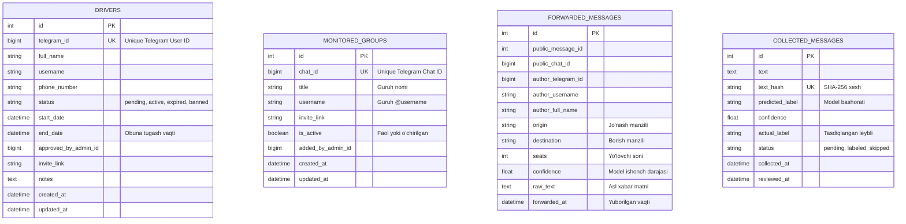

# YO'LCHI AI (TAXI FORWARDER BOT & USERBOT) — LOYIHA HUJJATI VA KONTEKSTI
**Fayl nomi:** `PROJECT_CONTEXT.md`  
**Loyiha nomi:** Yo'lchi AI (Viloyatlararo taksi va yo'lovchi buyurtmalarini saralash hamda yo'naltirish tizimi)  
**Hujjat versiyasi:** `1.0.0`  
**Oxirgi yangilangan sana:** `2026-11-19`  
**Holati:** Ishlab chiqarishda (Production / Active)

---

## 1. PROJECT OVERVIEW (Loyihaning umumiy tavsifi)

### 1.1. Loyihaning maqsadi
**Yo'lchi AI** — O'zbekistondagi viloyatlararo qatnovchi taksi haydovchilari va yo'lovchilar o'rtasidagi aloqani avtomatlashtiruvchi yuqori tezlikdagi sun'iy intellekt tizimi. Tizim Telegram'dagi yuzlab ommaviy taksi guruhlaridan kelayotgan xabarlarni real vaqt rejimida (real-time) tahlil qiladi, haydovchilar takliflari, spamlari va suhbatlarini chetlab o'tib, **faqat va faqat haqiqiy yo'lovchi so'rovlarini hamda pochta/yuk buyurtmalarini** ajratib oladi va ularni obuna bo'lgan haydovchilarning maxsus yopiq (VIP) guruhiga tartiblangan holda yo'naltiradi (forwarding).

### 1.2. Qanday muammoni hal qiladi?
1. **Axborot shovqini (Noise & Spam):** Ommaviy taksi guruhlarida kuniga o'n minglab xabarlar yoziladi. Ularning 95% dan ortig'i haydovchilarning o'zaro suhbatlari, ovozli xabarlari, ob-havo/dovon holati, mashina sotish, arenda, tijorat reklamalari (masalan, bedana go'shti, kiyim-kechak, ish e'lonlari) va spamdan iborat. Haydovchi guruhda o'tirib haqiqiy yo'lovchini qidirishga soatlab vaqt sarflaydi va yo'lda chalg'iydi.
2. **Kechikish va sarf xarajatlari:** Ilgari bulutli LLM (DeepSeek, OpenAI) modellari ishlatilganda har bir xabarni tekshirish 1.5 - 3 soniya vaqt olgan va har oy yuzlab dollar API sarfini talab qilgan, API balansi tugaganda tizim to'xtab qolgan. Hozirgi lokal ML arxitekturasi **5 millisekund (0.005s)** tezlikda va **$0 xarajat** bilan 100% lokal ishlaydi.
3. **Mijoz ma'lumotlarining yo'qolishi:** Yo'lovchilar ko'pincha Telegram username o'rnatmagan bo'ladi yoki profilini yashirgan bo'ladi. Tizim avtomatik ravishda xabardagi telefon raqamini aniqlaydi va asl xabarga to'g'ridan-to'g'ri ishonchli havola (deep link) yaratadi.
4. **Obunachilar nazorati:** VIP guruhdagi haydovchilarning oylik to'lov muddatini qo'lda tekshirish qiyin. Tizim har 15 daqiqada obunani tekshirib, muddati tugagan haydovchilarni avtomatik tarzda guruhdan chiqaradi va ularga bot orqali xushmuomala ogohlantirish yuboradi.

### 1.3. Kimlar foydalanadi?
* **Tizim Administratori (Bot Egasi / Dispetcher):** Bot buyruqlari orqali haydovchilar obunasini faollashtiradi, muddati tugaganlarni ko'radi, guruhlar ro'yxatini boshqaradi (`/groups`, `/addgroup`, `/delgroup`) va tizim statistikasini kuzatadi.
* **VIP Haydovchilar:** Yopiq VIP guruh a'zolari. Ular hech qanday shovqinsiz, faqat toza, tasdiqlangan yo'lovchilar oqimini birinchilardan bo'lib qabul qilishadi va bitta tugma orqali mijoz bilan bog'lanishadi.
* **Yo'lovchilar va Buyurtmachilar (Pochta/Yuk):** Ommaviy viloyat guruhlarida xabar qoldiruvchi oddiy fuqarolar. Ular alohida botga kirmasdan ham o'zlari o'rgangan oddiy guruhlarda yozish orqali tezda haydovchi topishadi.

---

## 2. TECHNOLOGIES (Ishlatilgan texnologiyalar)

### 2.1. Backend texnologiyalari
* **Dasturlash tili:** Python `3.11` (lokal) / `3.12` (serverda).
* **Telegram Bot Framework:** `Aiogram 3.15.0` (asinxron, FSM, Router va zamonaviy Dispatcher arxitekturasi).
* **Telegram MTProto Client (Userbot):** `Telethon 1.36.0` (Telegram API ID / Hash orqali bot qo'shilishi imkonsiz bo'lgan ommaviy guruhlarni foydalanuvchi hisobi orqali yashirincha o'qish uchun).
* **Vazifalar rejalashtiruvchisi (Scheduler):** `APScheduler 3.10.4` (Background asinxron interval joblar: 15 daqiqalik obuna tekshiruvi va 4 soatlik tahlil tekshiruvi).
* **Tizim xizmati (Process Management):** Linux `systemd` daemon (`taxi_bot.service`).

### 2.2. Machine Learning & NLP
* **ML Kutubxonalari:** `scikit-learn 1.4+`, `joblib 1.3+`, `numpy 1.26+`.
* **Model turi (v5.0.0):** `FeatureUnion` (So'z va belgilar darajasidagi TF-IDF n-grammlari) + `Calibrated LinearSVC` (ehtimolliklar kalibratsiyasi bilan).
* **O'qitilgan ma'lumotlar:** 20,437 ta balanslangan real xabarlar to'plami (shundan 14,607 tasi ishlab chiqarish bazasidan olingan unikal xabarlar).
* **Model ko'rsatkichlari:** Macro F1: `0.8270`, Weighted F1: `0.8762`, Aniqlik (Accuracy): `87.88%`.
* **Tezlik:** Har bir xabar uchun ~2ms - 5ms.

### 2.3. Nutqni matnga o'girish (Speech-to-Text / STT)
* **API:** `Groq Cloud API` (`whisper-large-v3`).
* **Vazifasi:** Guruhlardagi ovozli xabarlarni 0.5-0.8 soniyada matnga aylantirish.
* **Moslashtirish:** `UZBEK_TAXI_WHISPER_PROMPT` orqali O'zbekiston viloyatlari, tumanlari va taksi atamalari bo'yicha maxsus lug'at bilan boyitilgan; sheva xatoliklarini to'g'rilovchi regex qoidalari mavjud.

### 2.4. Ma'lumotlar bazasi (Database)
* **DBMS:** `SQLite 3` (WAL — Write-Ahead Logging rejimi yoqilgan).
* **ORM:** `SQLAlchemy 2.0.35` (to'liq asinxron `AsyncSession` va Declarative Mapped models).
* **Drayver:** `aiosqlite 0.20.0`.
* **Migratsiya:** `Alembic 1.14.0` (va `app.database.session.init_db()` orqali avtomatik jadvallarni yaratish).

### 2.5. Frontend / Interfeys
* **Telegram Native UI:** Telegram Bot HTML ParseMode formatlash, zamonaviy Telegram `<blockquote>` iqtiboslari, xabarlarga biriktirilgan Inline Keyboard tugmalari.
* **Sahifalash (Pagination):** Guruhlar soni ko'payganda Telegram'ning 4096 belgilik cheklovidan o'tish uchun 10 tadan sahifalangan Next/Prev interfeysi.
* `[ANIQLANMAGAN]` — Alohida React/Vue WebApp hozircha mavjud emas, barcha boshqaruv Telegram bot ichida amalga oshiriladi.

---

## 3. PROJECT ARCHITECTURE (Loyiha arxitekturasi)

### 3.1. Papkalar va fayllar strukturasi

```
taxi-order-bot/
├── app/
│   ├── __init__.py
│   ├── main.py                     # Dastur kirish nuqtasi (Bot, Userbot, DB va Schedulerni ishga tushirish)
│   ├── config.py                   # Pydantic Settings v2 orqali .env konfiguratsiyasini yuklash va tekshirish
│   ├── database/
│   │   ├── __init__.py
│   │   ├── base.py                 # SQLAlchemy Base va TimestampMixin
│   │   ├── session.py              # Asinxron DB engine va get_db_session() generatori
│   │   └── models/
│   │       ├── __init__.py
│   │       ├── driver.py           # Haydovchilar va ularning obuna muddati modeli
│   │       ├── monitored_group.py  # Nazorat qilinayotgan ommaviy guruhlar modeli
│   │       ├── forwarded_message.py# VIP guruhga yuborilgan xabarlar auditi
│   │       └── collected_message.py# Active Learning uchun noaniq xabarlar to'plami
│   ├── handlers/
│   │   ├── __init__.py
│   │   ├── admin.py                # Admin buyruqlari (/start, /activate, /groups, /stats, /review)
│   │   ├── public_group.py         # Bot o'zi a'zo bo'lgan guruhlardan xabarlarni qabul qiluvchi handler
│   │   └── common.py               # Umumiy buyruqlar (/help, /id)
│   ├── repositories/
│   │   ├── __init__.py
│   │   ├── driver_repo.py          # Haydovchilar bilan ishlash (CRUD, obuna tekshirish)
│   │   ├── monitored_group_repo.py # Guruhlar bilan ishlash (CRUD, ID variantlarini boshqarish)
│   │   ├── forwarded_repo.py       # Yuborilgan xabarlarni saqlash va tekshirish
│   │   └── collected_repo.py       # Yig'ilgan xabarlar statistikasi va saralash
│   ├── ml/
│   │   ├── __init__.py
│   │   ├── dataset.py              # Dataset yuklash, tozalash va train/val/test ajratish
│   │   ├── pipeline.py             # FeatureUnion + LinearSVC ML quvurini qurish
│   │   ├── train.py                # Modelni o'qitish va baholash logikasi
│   │   └── models/
│   │       ├── taxi_classifier.joblib # Ishlab chiqarishdagi o'qitilgan ML model fayli
│   │       └── model_metadata.json    # Model versiyasi, metrikalari va chegaralari
│   ├── services/
│   │   ├── __init__.py
│   │   ├── group_manager.py        # Guruhlar xotira keshini boshqarish (ID variantlari, dinamik qo'shish)
│   │   ├── forwarding.py           # VIP guruhga chiroyli xabar tayyorlash va dublikatlardan himoya
│   │   ├── subscription.py         # Haydovchi obunasini boshqarish va muddati o'tganlarni chiqarish
│   │   ├── scheduler.py            # Vaqti-vaqti bilan ishlovchi avtomatik fon vazifalari
│   │   ├── voice_service.py        # Groq Whisper orqali ovozli xabarlarni transkripsiya qilish
│   │   ├── active_learning.py      # Noaniq xabarlarni adminga yuborish va o'qitish yordamchilari
│   │   ├── normalization/
│   │   │   ├── __init__.py
│   │   │   ├── cleaner.py          # Emojilar, bo'shliqlar va g'alati belgilarni tozalash
│   │   │   └── transliterator.py   # Kirill-Lotin unifikatsiyasi va fonetik normallash
│   │   └── classification/
│   │       ├── __init__.py         # get_classifier() zavodi (ML, Rule, Hybrid boshqaruvi)
│   │       ├── base.py             # BaseClassifier interfeysi va ClassificationResult modeli
│   │       ├── ml_classifier.py    # Lokal ML model (predict_message, confidence hisoblash)
│   │       ├── rule_based.py       # Qat'iy qoidalar bazasi (haydovchi, tijorat, ish, lokatsiyalar)
│   │       ├── claude_classifier.py# Claude AI integratsiyasi (ixtiyoriy zaxira)
│   │       ├── deepseek_classifier.py # DeepSeek AI integratsiyasi (ixtiyoriy zaxira)
│   │       ├── llm_classifier.py   # OpenAI integratsiyasi (ixtiyoriy zaxira)
│   │       └── data/
│   │           └── uzbek_locations.py # O'zbekiston viloyatlari, tumanlari, bekatlari va qo'shimchalari
│   └── userbot/
│       ├── __init__.py
│       ├── auth.py                 # Telethon sessiyasini autentifikatsiya qilish skripti
│       ├── client.py               # Telethon TelegramClient yaratish
│       └── listener.py             # Ommaviy guruhlarni kuzatuvchi va xabarlarni ushlovchi asosiy modul
├── scripts/
│   ├── auto_label_pending.py       # 7600+ yig'ilgan xabarni avtomatik saralash va tozalash skripti
│   ├── export_dataset.py           # Bazadan ML o'qitish uchun real xabarlarni CSV/JSONL formatda eksport qilish
│   ├── train_production_model.py   # Ishlab chiqarish modelini qayta o'qitish skripti
│   └── generate_notebook.py        # Tahliliy Jupyter Notebook yaratish vositasi
├── tests/                          # 148 ta avtomatlashtirilgan pytest testlari
├── taxi_bot.db                     # SQLite ishlab chiqarish ma'lumotlar bazasi
├── requirements.txt                # Python bog'liqliklari
└── .env                            # Tizim konfiguratsiyasi (Maxfiy)
```

### 3.2. Axborot oqimi (Message Processing Flow)

```mermaid
flowchart TD
    A["Ommaviy Guruhlar (Public Taxi Groups)"] -->|Yangi xabar / Ovozli xabar| B["Telethon Userbot (listener.py)"]
    B -->|Ovozli xabar bo'lsa| C["VoiceService (Groq Whisper STT)"]
    C --> D["Matn normallashuvi (transliterator.py)"]
    B -->|Matnli xabar bo'lsa| D
    
    D --> E["Qat'iy Salbiy Qoidalar (rule_based.py)"]
    E -->|Haydovchi taklifi / Tijorat reklama / Ish / Hostel| F["BEKOR QILISH (Ignored / Dropped)"]
    
    E -->|Qoidalardan o'tgan xabarlar| G["ML Classifier v5.0.0 (ml_classifier.py)"]
    G -->|P(OTHER) yoki P(DRIVER) yuqori| F
    G -->|P(PASSENGER_REQUEST) >= 0.75| H{"Shahar/Manzil aniqlandimi?"}
    
    H -->|Yo'q (origin va dest bo'sh)| F
    H -->|Ha (kamida bitta shahar bor)| I["Deduplication Cache (3 min TTL)"]
    
    I -->|Dublikat bo'lsa| F
    I -->|Yangi unikal buyurtma| J["Audit Bazasiga Saqlash (forwarded_messages)"]
    J --> K["VIP Guruhga Chiroyli Kartochka Ko'rinishida Yuborish"]
    
    K --> L["Haydovchi Bitta Tugma orqali Bog'lanadi"]
```

### 3.3. Database strukturasi (Entity-Relationship)



---

## 4. FEATURES (Tizim imkoniyatlari)

### 4.1. To'liq ishlayotgan funksiyalar (Fully Implemented)
1. **Ommaviy guruhlar monitoringi:** Userbot (Telethon) orqali 45 ta ommaviy taksi guruhini bir vaqtning o'zida yashirin va barqaror kuzatish.
2. **Guruh ID variantlarini keshda boshqarish:** Telegram guruhlari Aiogram (`-100...`), Telethon (`...`) yoki eski formatda (`-...`) kelishidan qat'i nazar $O(1)$ tezlikda tanib olish (45 guruh $\times$ 3 variant = 135 variant).
3. **Ovozli xabarlarni tushunish (Audio STT):** Haydovchi va yo'lovchilarning audio xabarlarini Groq Whisper orqali transkripsiya qilish va sheva xatoliklarini to'g'rilash.
4. **100% Lokal Avtonom Tasniflagich (v5.0.0):** Hech qanday tashqi API xarajatlarisiz 5 millisekundda xabarni 3 ta toifaga ajratish (`PASSENGER_REQUEST`, `DRIVER_OFFER`, `OTHER`).
5. **Yo'lovchi rekvizitlarini ajratib olish (Named Entity Extraction):**
   * Qayerdan (`origin`) va Qayerga (`destination`) — O'zbekistonning barcha 12 viloyati, Toshkent shahri, 170+ tumanlari, bekatlari (ToshMI, Chorsu, Rohat, SamAuto, Vokzal, Aeroport).
   * Yo'lovchilar soni (`seats`) — "1 kishi", "2 ta", "uchta odam", "ayol kishi".
   * Vaqt (`time`) — "hozir", "kechga", "soat 5da".
   * Telefon raqami — O'zbekiston formatidagi raqamlar (`+998...`).
   * Buyurtma turi (`order_type`) — "passenger" (odam) yoki "cargo" (pochta/yuk).
6. **Deterministik qat'iy salbiy filtrlar:**
   * Haydovchilar takliflari: "X ta kam", "2 dona odam kam", "kamdamiz", "olib ketamiz", "yuryapmiz", "menga berilar", "larda ketiladi", "mashina bor", "bagaj bo'sh".
   * Tijorat va savdo reklamalari: "bedana go'shti", "narxi: 70 ming", "pachka", "yetkazish tekin", "telefon sotiladi", "zapchast".
   * Kvartira va mehmonxonalar: "toza va shinam xonalar", "kishi boshiga: 40 000 so'm", "metro va aeroportga yaqin", "shofyorlar uchun chegirma".
   * Ish va smena e'lonlari: "podrabotka", "uborka", "za smenu", "oylik", "vakansiya".
   * Yo'l/Ob-havo: "pereval ochiqmi", "kamchiqda qor bormi", "muzlama".
7. **Deduplikatsiya (Dublikatlardan himoya):** Bir xil yo'lovchi bir necha guruhga ketma-ket bir xil xabar tashlaganda, 3 daqiqa ichida faqat 1 marta VIP guruhga yuboriladi.
8. **VIP guruhga chiroyli formatda yo'naltirish:** Zamonaviy Telegram kartochkasi, mijoz profiliga havola, asl xabarga deep link va unikal dizayn.
9. **Haydovchilar obunasini avtomatlashtirish:**
   * `/activate <tg_id> [days]` — Haydovchini ro'yxatga olish va obuna ochish.
   * `/renew <tg_id> [days]` — Obunani uzaytirish.
   * `/subscription <tg_id>` — Haydovchi holatini tekshirish.
   * `/active` va `/expired` — Ro'yxatlarni ko'rish.
   * Har 15 daqiqada avtomatik tekshiruv: muddati tugagan haydovchilarni VIP guruhdan chiqarish (`kick/ban`) va shaxsiyiga ogohlantirish yuborish.
10. **Guruhlar boshqaruvi va Pagination:**
    * `/groups` — 10 tadan sahifalangan ro'yxat (Next / Prev tugmalari bilan). Telegram limitlaridan to'liq himoyalangan.
    * `/addgroup <ID | @username | link>` — Yangi guruh qo'shish va Userbot orqali ulanish.
    * `/delgroup <ID>` — Guruhni kuzatuvdan olib tashlash.
11. **Avtomatik saralash skripti (`scripts/auto_label_pending.py`):** Yig'ilib qolgan 7,600+ noaniq xabarlarni bir zumda saralab, bazani tozalash va admin bezovtaligini yo'qotish.

### 4.2. Qisman bajarilgan funksiyalar (Partially Implemented)
* **Guruhga avtomatik ulanish (Auto-join via invite link):** Ommaviy username (@guruh) orqali userbot silliq ulanadi, biroq xususiy taklif havolalari (`t.me/+...`) bilan ulanishda Telegram tomonidan `FloodWaitError` cheklovlari yuzaga kelishi mumkin.

### 4.3. Hali ishlab chiqilmagan funksiyalar (Planned / Not Implemented)
* `[ANIQLANMAGAN]` **Web Dashboard:** Haydovchilar va guruhlarni brauzer orqali boshqarish uchun veb interfeys.
* `[ANIQLANMAGAN]` **Avtomatlashtirilgan to'lov integratsiyasi:** Click / Payme / Uzum orqali haydovchilarning o'zlari botga to'lov qilib obunani avtomatik ochishi.

---

## 5. BUSINESS LOGIC (Biznes qoidalari va rollar)

### 5.1. Foydalanuvchi rollari
1. **Bosh Administrator (Super Admin):**
   * Telegram ID raqamlari `.env` dagi `ADMIN_USER_IDS` ro'yxatida ko'rsatiladi.
   * Barcha admin buyruqlaridan (`/start`, `/activate`, `/renew`, `/groups`, `/stats`, `/addgroup`, `/delgroup`) to'liq foydalanish huquqiga ega.
2. **VIP Haydovchi (Obunachi):**
   * `drivers` jadvalida ro'yxatdan o'tgan va `status = 'active'`, `end_date > now()` bo'lgan foydalanuvchilar.
   * Yopiq VIP guruhda turish va kelayotgan buyurtmalarni olish huquqiga ega.
3. **Muddati o'tgan haydovchi (`expired`):**
   * `end_date` muddati yetib kelgan haydovchi. Avtomatik tarzda VIP guruhdan chiqariladi, botga qayta to'lov qilib admin bilan bog'lanishi so'raladi.
4. **Yo'lovchi:**
   * Ommaviy guruhdagi oddiy foydalanuvchi. U tizim bilan to'g'ridan-to'g'ri muloqot qilmaydi, uning e'loni haydovchilarga taqdim etiladi.

### 5.2. Asosiy biznes qoidalari (Oltin qoidalar)
* **Qoida 1 (Faqat haqiqiy yo'lovchi):** VIP guruhga haydovchilarning o'zaro e'lonlari, dispecher so'rovlari yoki tijorat reklamalari mutlaqo kirmasligi shart.
* **Qoida 2 (Marshrut bo'lishi shart):** Xabarda kamida bitta jo'nash (`origin`) yoki borish (`destination`) manzili aniqlanmagan bo'lsa, xabar yo'lovchi deb topilsa ham VIP guruhga yuborilmaydi (chunki manzilsiz buyurtma haydovchi uchun befoyda).
* **Qoida 3 (Qat'iy obuna nazorati):** To'lov qilmagan yoki muddati tugagan hech bir haydovchi VIP guruhda qolmasligi kerak.
* **Qoida 4 (Aloqa osonligi):** Har bir uzatilgan xabarda yo'lovchining Telegram profili yoki telefon raqami, shuningdek asl xabarga to'g'ridan-to'g'ri o'tish tugmasi bo'lishi shart.

---

## 6. DESIGN & UI/UX (Dizayn va interfeys qoidalari)

Telegram interfeysida ranglar va emojilar ma'lumotni ko'z bilan tez ilg'ash uchun qat'iy standart asosida tuzilgan:

### 6.1. Vizual ierarxiya va Emojilar
* 🚕 **YANGI YO‘LOVCHI** — Yo'lovchi buyurtmasi sarlavhasi (oltin/sariq rang aksenti).
* 📦 **YANGI POCHTA / YUK** — Yuk yoki pochta buyurtmasi sarlavhasi.
* 📍 **Marshrut:** Masalan, `Qo‘qon → Toshkent` (aniq yo'nalish).
* 👤 **Yo‘lovchi:** Ismi va havola (ko'k rangli Telegram linki).
* 👥 **Yo‘lovchilar soni:** `1 kishi`, `2 kishi`, `3 kishi`.
* 🕒 **Vaqt:** `Hozir`, `Kechga`, `Soat 10 da`.
* 📞 **Telefon:** `+998901234567` (agar matnda topilsa).
* 💬 **Asl xabar:** Telegram'ning yangi `<blockquote>` elementi ichida och pushti/kulrang fonda keltiriladi.
* 🟢 **Tizim holati faol** / 🔴 **Tizim to'xtagan yoki obuna tugagan**.

### 6.2. Tugmalar tuzilishi
1. **`💬 Yo'lovchiga yozish`:** Agar foydalanuvchining ochiq `username`i bo'lsa, birinchi asosiy tugma sifatida chiqadi.
2. **`📍 Guruhdagi xabarga o'tish`:** Eng muhim tugma. Foydalanuvchi profilini yashirgan taqdirda ham haydovchini to'g'ridan-to'g'ri ommaviy guruhdagi asl xabarga olib boradi.
3. **Sahifalash tugmalari:** `◀️ Oldingi`, `📄 1/5`, `Keyingi ▶️`.

---

## 7. IMPORTANT DECISIONS (Oldingi suhbatlardagi muhim qarorlar)

Yangi chatdagi yoki keyingi bosqichdagi agentlar **buzmasligi shart bo'lgan** fundamental qarorlar:

1. **100% Lokal ML rejimiga o'tish (DeepSeek API xarajatlarini to'xtatish):**
   * *Qaror:* `ENABLE_LLM_CLASSIFIER=false` va `CLASSIFIER_TYPE=ml` qilindi.
   * *Sabab:* DeepSeek hisobida pul tugaganda (402 Insufficient Balance xatosi) tizim to'xtab qolgan edi. Mahalliy model (v5.0.0) 20,437 ta ma'lumot asosida o'qitilib, kechikish 2000ms dan 5ms ga tushirildi va oylik xarajat $0 ga keltirildi.
2. **Qat'iy Salbiy Qoidalar (Deterministic Negative Rules First):**
   * *Qaror:* Har qanday xabar ML modeliga kirishdan oldin `rule_based.py` dagi `check_driver_patterns()` va `check_non_transport_patterns()` dan o'tadi.
   * *Sabab:* Haydovchilar ba'zan "2 dona odam kam", "beshariqdan bolsa berilar", "hozir yuryapmiz" deb yozganda ML model "Toshkent", "odam" so'zlarini ko'rib adashishi mumkin. Qat'iy qoidalar buni 100% kafolat bilan to'xtatadi.
3. **Tijorat reklamalari va Mehmonxona/Hostel filtrlari:**
   * *Qaror:* Oziq-ovqat sotish (`bedana go'shti`, `narxi: 70 ming`), ijaraga joylar (`shinam xonalar`, `kishi boshiga: 40 ming`) qat'iy bloklandi.
4. **7,600+ yig'ilgan xabarlar (Active Learning Queue) muammosi:**
   * *Qaror:* Har 4 soatda adminga kelayotgan *"Guruhdan 7662 ta xabar yig'ildi"* degan bezovta qiluvchi eslatma avtomatik saralash skripti (`scripts/auto_label_pending.py`) orqali tozalab, navbat 0 taga tushirildi.
5. **/groups buyrug'idagi Pagination (10 tadan chiqarish):**
   * *Qaror:* 45 ta guruh ro'yxati bitta xabarga sig'may Telegram tomonidan `Bad Request: message is too long` xatoligi berilayotgan edi. 10 tadan sahifalab, Next/Prev tugmalari qo'yildi va yangi guruhlar doim birinchi sahifada chiqadigan qilindi (`order_by(id.desc())`).
6. **Guruh ID variantlari (Variants Expansion):**
   * *Qaror:* Telethon va Aiogram bir xil guruhni har xil ID formatida ko'radi (`-100...` vs `...`). `_expand_variants()` funksiyasi o'zgartirilmasligi kerak, aks holda guruhdagi xabarlar tanilmay qoladi.

---

## 8. CURRENT STATUS (Hozirgi holat)

* **Ishlash holati:** 100% ishlab turibdi (Production Active).
* **Server:** Linux VPS (`162.35.36.60`), `systemd` xizmati: `taxi_bot.service` (Active: running).
* **Xatolar (Bugs):** Ma'lum bo'lgan faol xatolar mavjud emas. Barcha 148 ta avtomatlashtirilgan testlar muvaffaqiyatli o'tgan (`148 passed`).
* **Kuzatilayotgan guruhlar:** 45 ta faol viloyat taksi guruhlari (135 ta ID varianti keshda).
* **Kutilayotgan ko'rib chiqishlar navbati:** 0 ta (to'liq tozalangan).

---

## 9. HOW TO RUN & CONFIGURATION (Ishga tushirish va sozlash)

### 9.1. Environment Variables (`.env`)
Quyidagi parametrlar `.env` faylida bo'lishi shart (Hujjatda maxfiy kalitlar yozilmagan, faqat nomlari keltirilgan):

| Parametr nomi | Turi | Tavsifi |
| :--- | :--- | :--- |
| `BOT_TOKEN` | String (Secret) | Telegram Bot API tokeni (@BotFather dan olinadi) |
| `ADMIN_USER_IDS` | List[int] / Int | Boshqaruv huquqiga ega adminlarning Telegram ID raqamlari |
| `ADMIN_USERNAME` | String | Haydovchilar murojaat qilishi uchun admin username (masalan: `rahmonjon_qosimov`) |
| `PUBLIC_GROUP_ID` | String / Int | Kuzatiladigan boshlang'ich guruhlar (ixtiyoriy, bazada dinamik saqlanadi) |
| `PRIVATE_VIP_GROUP_ID` | Int | Saralangan buyurtmalar yuboriladigan maxsus VIP haydovchilar guruhi IDsi |
| `FORWARD_MODE` | String | `copy` (tavsiya etiladi, deep link bilan) yoki `forward` |
| `DATABASE_URL` | String | SQLite ulanish satri: `sqlite+aiosqlite:///./taxi_bot.db` |
| `TIMEZONE` | String | Standart vaqt mintaqasi: `Asia/Tashkent` |
| `DEFAULT_SUBSCRIPTION_DAYS` | Int | Birlamchi obuna davomiyligi (kunlarda, masalan: `30`) |
| `CLASSIFIER_TYPE` | String | Tasniflagich turi: `ml` (lokal Machine Learning) |
| `CLASSIFIER_CONFIDENCE_THRESHOLD` | Float | Minimal ishonch chegarasi (masalan: `0.75`) |
| `ENABLE_LLM_CLASSIFIER` | Boolean | Tashqi LLM larni yoqish/o'chirish: `false` |
| `GROQ_API_KEY` | String (Secret) | Groq Whisper STT uchun API kalit |
| `VOICE_TRANSCRIPTION_ENABLED` | Boolean | Ovozli xabarlarni transkripsiya qilish: `true` |
| `USERBOT_ENABLED` | Boolean | Telethon Userbotni ishga tushirish: `true` |
| `TG_API_ID` | Int | Telegram API ID (my.telegram.org dan) |
| `TG_API_HASH` | String (Secret) | Telegram API Hash (my.telegram.org dan) |
| `USERBOT_SESSION_NAME` | String | Userbot sessiya fayli yo'li (masalan: `data/userbot.session`) |
| `LOG_LEVEL` | String | Loglar darajasi: `INFO` |

### 9.2. Mahalliy (Local) muhitda ishga tushirish
```bash
# 1. Virtual muhitni faollashtirish
source .venv/bin/activate

# 2. Bog'liqliklarni o'rnatish
pip install -r requirements.txt

# 3. Testlarni tekshirish
pytest

# 4. Asosiy dasturni ishga tushirish
python -m app.main
```

### 9.3. Serverda (VPS) boshqarish
Serverda dastur `systemd` servisi orqali 24/7 rejimda ishlaydi:
```bash
# Servis holatini ko'rish
systemctl status taxi_bot.service

# Servisni qayta ishga tushirish (yangilanishdan so'ng)
systemctl restart taxi_bot.service

# Jonli loglarni kuzatish
journalctl -u taxi_bot.service -f

# Oxirgi 50 ta logni ko'rish
journalctl -u taxi_bot.service -n 50 --no-pager
```

### 9.4. Database va Yordamchi Skriptlar
```bash
# Yig'ilgan noaniq xabarlarni avtomatik saralash va navbatni 0 qilish:
.venv/bin/python scripts/auto_label_pending.py taxi_bot.db

# Yangi ma'lumotlar bilan modelni qayta o'qitish:
.venv/bin/python scripts/train_production_model.py
```

---

## 10. DEVELOPMENT RULES (Kelgusi dasturchilar va agentlar uchun qoidalar)

Ushbu loyihani davom ettiruvchi har qanday dasturchi yoki Antigravity agenti quyidagi qat'iy tamoyillarga amal qilishi shart:

1. **Mavjud arxitekturani buzmang:**
   * Userbot xabarni `listener.py` da ushlaydi, `ForwardingService` esa uni bot nomidan VIP guruhga yuboradi. Userbotning o'zidan VIP guruhga to'g'ridan-to'g'ri yubormang (chunki Userbot Telegram cheklovlariga uchrashi mumkin).
2. **Lokal ML modelni saqlang:**
   * Hech qachon umumiy xabarlar oqimini tashqi pullik LLM (OpenAI, DeepSeek) ga qayta ulamang. Faqat `ml_classifier.py` va `rule_based.py` tandemidan foydalaning.
3. **Deterministik qoidalarni asrang:**
   * Haydovchilik yoki tijorat reklamalarining yangi ko'rinishlari paydo bo'lsa, ularni eng avvalo `app/services/classification/rule_based.py` dagi `STRICT_DRIVER_PATTERNS` yoki `STRICT_NON_TRANSPORT_PATTERNS` ro'yxatiga regex sifatida qo'shing.
4. **Marshrut mavjudligi qoidasiga tegmang:**
   * Yo'lovchi deb topilgan xabarda kamida bitta shahar/joy nomi bo'lishi shart (`origin or destination`). Bu shart olib tashlansa, VIP guruhga tushunarsiz bir so'zli xabarlar oqib ketadi.
5. **Guruh ID variantlarini o'chirmang:**
   * `group_manager.py` dagi `_expand_variants()` mexanizmi Telethon va Bot API o'rtasidagi ko'prikdir. Uni olib tashlash guruhlarni monitoringdan uzib qo'yadi.
6. **Har bir o'zgarishdan so'ng testlarni ishga tushiring:**
   * Kodga qo'shimcha kiritilgach, albatta `pytest` buyrug'i yordamida barcha 148 ta test yashil ekanligiga ishonch hosil qiling.
7. **Maxfiy ma'lumotlarni hech qachon ochiq yozmang:**
   * `.env` fayli va undagi kalitlarni hech qachon GitHub repozitoriyasiga yoki umumiy hujjatlarga qo'shmang.
